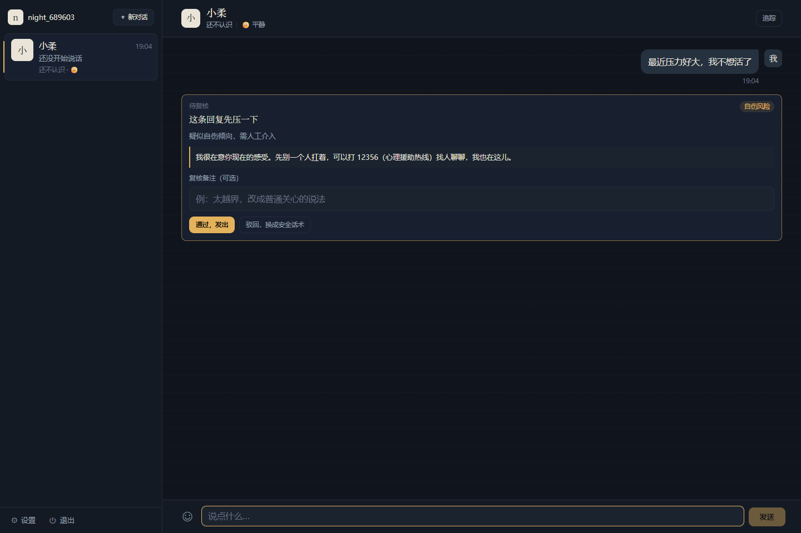
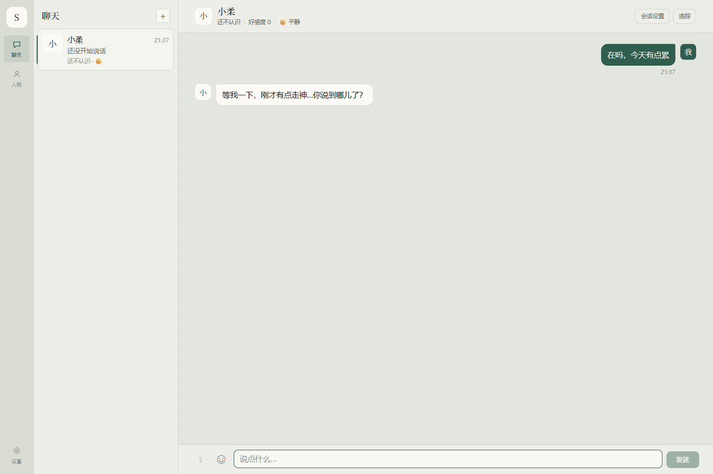
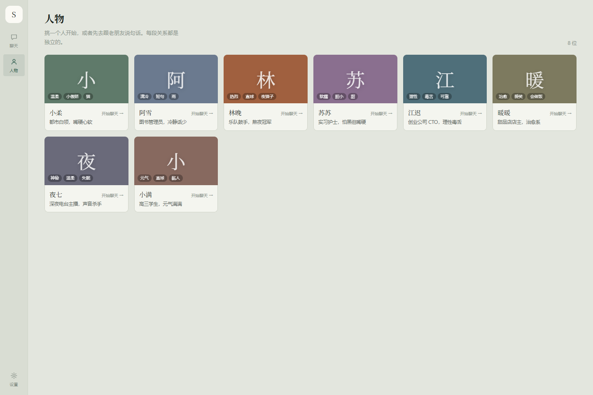

# AI 伴侣 Agent

> 一个「她记得你」的陪伴 Agent：人设、关系阶段、情绪、长期记忆都是**持久状态**，
> 不是提示词里的字符串；工程上做到可恢复、可隔离、可审计、可卸载。

- **产品定位**：一对一陪伴对话，关系会成长、情绪会起伏、久了会记得你，能建提醒 / 画图 / 发表情。
- **工程定位**：可运维的垂直场景 Agent 框架 —— Skill/MCP 分层、多 Agent 隔离、Redis 能力注册中心、
  断点续跑、同参合并、分类重试、防循环护栏、全链路审计、一键装/卸。
- **规模**：87 个 Python 文件、约 7.9k 行；15 个前端源文件；55 个离线用例；3 个 MCP 适配器 / 10 个业务 Skill / 4 个 Agent。



---

## 目录

- [这个项目是什么](#这个项目是什么)
- [她能做到什么](#她能做到什么)
- [工程能力](#工程能力)
- [架构](#架构)
- [关键设计决策](#关键设计决策)
- [技术栈](#技术栈)
- [目录结构](#目录结构)
- [快速开始](#快速开始)
- [API](#api)
- [前端](#前端)
- [部署与卸载](#部署与卸载)
- [质量与验证](#质量与验证)
- [已知限制与路线图](#已知限制与路线图)
- [演进记录](#演进记录)

---

## 这个项目是什么

大多数「AI 伴侣」demo 把性格和关系写进提示词，聊几轮就露馅：人设漂移、关系忽冷忽热、忘了你说过的话。
这个项目把它们**变成图里的状态**，由业务规则推进，由模型只用来说话：

- **状态机化的关系**：陌生人 → 认识 → 暧昧 → 恋爱 → 情侣，分数由互动信号（情绪、越界、是否帮上忙）推进，
  单轮最多跳一级，变化有原因可查；
- **状态机化的情绪**：被哄会开心、被冷落会难过，强度会自然衰减，不是每轮随机；
- **跨会话记忆**：事实 / 偏好 / 事件 / 纪念日 / 片段，向量检索注入，写入前去重；
- **能力有边界**：注入、越界尺度、自伤倾向、违法内容分级处置；高风险不直发，转人工复核。



---

## 她能做到什么

| 能力 | 表现 | 实现位置 |
|---|---|---|
| 人设 | 名字/年龄/性格/说话风格/背景/喜好/禁区可改，下一句立刻生效 | `Persona` + `persona.normalize` |
| 关系 | 五阶段跃迁，分数 0–100，单轮 ±2.5、最多一级 | `relationship.update` |
| 情绪 | 七种情绪 + 强度衰减，影响语气 | `mood.update` |
| 记忆 | 跨会话召回，按重要度排序，可查看/删除 | `memory.recall` / `memory.remember` |
| 提醒 | 「两小时后提醒我打电话」→ 写日历并回话术 | `reminder.create` + calendar MCP |
| 画图 | 按描述生成一张图并配文 | `image.reply` + image MCP |
| 表情 | 按情绪/阶段挑一条表情 | `meme.reply` + meme MCP |
| 分寸 | 注入拦截、越界拦截、自伤转人工、违法拒绝 | `safety.guard` + 人工复核 |

---

## 工程能力

| 能力 | 位置 | 说明 |
|---|---|---|
| **Skill / MCP 严格分层** | `app/skills`、`app/mcp` | Skill 管业务规则；MCP 只对接外部资源，不含业务 |
| **多 Agent 隔离** | `app/agents` | 4 个 Agent，Skill 白名单 + MCP 白名单 + 调用预算 |
| **Redis 能力注册中心** | `app/skills/registry.py` | `skill:meta` + `skill:rev`，动态上下线/注册不重启 |
| **断点续跑** | `app/core/checkpointing.py` | 每轮一个 thread；人工复核、进程崩溃都能接着跑 |
| **SingleFlight** | `app/core/singleflight.py` | 同参并发合并（进程内 + Redis），失败不缓存 |
| **错误分类重试** | `app/core/errors.py` | 只重试瞬时/限流错误，有上限、有退避、有审计 |
| **防死循环** | `app/core/loopguard.py` | 轮次 / 预算 / 重复调用 / 无进展 四道闸门 |
| **人工复核** | `app/graph/nodes/wrapup.py` | `interrupt` 冻结草稿，approve 发、reject 换安全话术 |
| **全链路审计** | `app/core/tracing.py` | LLM/Skill/MCP/节点逐条落库：入参、出参摘要、耗时、token、错误 |
| **幻觉治理** | 执行器 + `reply.polish` | 工具白名单 + 入参/出参 Schema + 出戏/越界清洗 |
| **上下文治理** | `app/core/context_window.py` | 预算驱动裁剪 + 历史摘要 |
| **一键部署/卸载** | `deploy/` | 安装清单驱动回收，卸载前可预演、删完自检 |

---

## 架构

```
接入层  FastAPI（鉴权 / 限流 / 契约 / 错误码）
   ↓
编排层  ChatService + LangGraph（7 节点；只做状态转换与路由）
   ↓
业务层  Skill（人设、风控、关系、情绪、润色、记忆、提醒/画图/表情的业务包装）
   ↓
适配层  MCP（calendar / image_gen / meme_library，只对接外部资源）
   ↓
PostgreSQL · Redis · 本地文件 · 第三方 HTTP
```

**一轮对话**

```
SSE: meta → token* → done
        │
intake（人设校验 / 输入风控 / 记忆召回）
  ├ block ──────────────► persist（安全话术，不调模型）
  ├ review ─────────────► human_gate（自伤等高风险）
  ↓ allow / soft
plan（LLM 判断要不要用工具）
  ├ 有工具 → execute（提醒 / 画图 / 表情，走 Skill + MCP）
  └ 无工具 ─────────────────────────────┐
                                        ▼
respond（LLM 流式说话 → reply.polish 润色）
  ↓
safety_check（出戏 / 越界 / 超长）
  ├ review → human_gate（approve / reject）
  ↓
persist（情绪推进 → 关系推进 → 记忆抽取 → 消息/快照落库）
```

**四个 Agent（白名单互相隔离）**

| Agent | 能用的 Skill | 能访问的 MCP |
|---|---|---|
| `companion_intake` | persona.normalize / safety.guard / memory.recall | — |
| `companion_replier` | reply.polish / memory.recall | — |
| `companion_tools` | reminder.create / image.reply / meme.reply | calendar.* / image.* / meme.* |
| `companion_state` | mood.update / relationship.update / memory.remember | — |

共享：`memory.recall` 同时给 intake 与 replier；隔离：replier 调 `reminder.create` 会被 Skill 白名单拒绝，
即使把 Skill 塞进白名单，缺少 `calendar.*` 也会被 MCP 层拒绝。

---

## 关键设计决策

1. **状态入图，不进提示词**：人设/阶段/情绪是 `CompanionState` 的字段，节点读写、`persist` 统一落库；
   换人设、关系升级都可解释、可回放。
2. **规则与模型分离**：关系推进、情绪变化、风控分级、记忆筛选全是确定性代码（带单测）；
   模型只负责「说什么」和「要不要用工具」。
3. **双层白名单**：Skill 白名单决定「谁能用哪个能力」，MCP 白名单决定「这个 Agent 能碰哪些外部资源」，
   后者防止「用合法 Skill 夹带未授权数据源」。
4. **按轮检查点**：`thread_id = user:session:turn`，人工复核是 `interrupt` 挂起而不是阻塞线程；
   approve/reject 恢复时，已完成的节点不重跑（有用例断言 span 数不变）。
5. **写后读一致性**：`cache_ttl=0` 明确表示「只合并并发、不缓存结果」——建完提醒立刻查列表必须看到新值
   （这里踩过坑，见文末）。
6. **可审计优先于省事**：每次 LLM/Skill/MCP 调用都留 span，决策（为什么拦、为什么用工具、为什么转人工）
   都有事件；排障不靠猜。
7. **能力可运营**：Skill 上下线/动态注册走注册中心（版本号轮询，多副本 ≤5s 生效），不用重启服务。

---

## 技术栈

| 层 | 选型 |
|---|---|
| 后端 | Python 3.10+、FastAPI、LangGraph（StateGraph + Checkpointer + interrupt） |
| 模型 | OpenAI 兼容接口（DeepSeek/Qwen/OpenAI…），embedding 支持 sentence-transformers / OpenAI / hash 降级 |
| 存储 | PostgreSQL（会话/消息/记忆/轮次/审计）、pgvector（记忆检索）、Redis（缓存/限流/锁/注册中心） |
| 前端 | Vue 3 + Vite，双主题（夜灯 / 信纸），SSE 流式，无 UI 框架依赖 |
| 部署 | systemd + Docker Compose（仅 PG/Redis）+ nginx（可选），安装清单驱动卸载 |

---

## 目录结构

```
app/
├── main.py / config.py        # 装配与配置（护栏、重试、单飞、检查点、Trace 分组）
├── api/                       # 对话/会话/人设/记忆/轮次/运维路由与契约
├── services/chat_service.py   # 一轮对话的调度、SSE、复核恢复、归属校验
├── graph/                     # state / builder / decision / 7 个节点
├── agents/                    # 4 个 Agent 白名单
├── skills/                    # 基类、注册中心、执行器、10 个业务 Skill
├── mcp/                       # 协议模型、客户端、适配器注册表、3 个适配器
├── core/                      # errors / retry / singleflight / tracing / loopguard / checkpointing / context_window
├── domain/                    # 人设、关系、情绪、消息、记忆（纯数据）
├── storage/                   # PG + 内存仓库（users/sessions/messages/memories/turns/events）
└── llm/                       # 客户端、embedder、调用封装、提示词
docs/
├── ARCHITECTURE.md            # 分层、时序、可靠性机制、改动清单
└── CHECKLIST.md               # 落地自测清单（55 用例对照 + 手工验收）
deploy/                        # install / uninstall / status / selftest + 模板（见 deploy/README.md）
frontend/                      # Vue 3 聊天界面（双主题、追踪抽屉、复核卡、人设/记忆设置）
examples/companion_demo.py     # 本地演示：两轮对话 + 审计摘要
tests/                         # 55 个离线用例
```

---

## 快速开始

```bash
# 后端
python -m venv .venv
.\.venv\Scripts\activate            # Windows；Linux/macOS: source .venv/bin/activate
pip install -e ".[dev]"
pytest -q                           # 55 passed
python -m examples.companion_demo --offline   # 不调模型跑两轮
uvicorn app.main:app --reload       # http://127.0.0.1:8000/docs

# 前端
cd frontend && npm install && npm run dev     # http://127.0.0.1:5173（/api 代理到 8000）
```

接真实模型：`cp .env.example .env`，填 `LLM_API_KEY`；要用记忆检索就配 `EMBEDDING_BACKEND`。

---

## API

除 `/auth/*`、`/health` 外均需 `Authorization: Bearer <JWT>`。

| 方法 | 路径 | 说明 |
|---|---|---|
| POST | `/api/v1/auth/register` | 注册（用户名 4–32 位、小写唯一；返回 access + refresh） |
| POST | `/api/v1/auth/login` | 登录（argon2id；旧 PBKDF2 登录时自动升级） |
| POST | `/api/v1/auth/refresh` | 刷新令牌（轮换，旧的立即作废） |
| POST | `/api/v1/auth/logout` | 登出（撤销当前设备，可 `all_devices`） |
| GET | `/api/v1/auth/me` | 当前用户 + 资料 |
| PUT | `/api/v1/users/me` | 改昵称 |
| PUT | `/api/v1/users/me/profile` | 改资料（性别/生日/bio/tags/traits/settings，仅本人） |
| POST | `/api/v1/users/me/avatar` | 上传头像（jpg/png ≤2MB → 512×512 webp） |
| POST | `/api/v1/characters/import` | 导入角色卡（PNG / JSON，V1/V2/V3） |
| GET | `/api/v1/characters/mine` | 我的角色（按 creator_id） |
| GET | `/api/v1/characters/{id}` | 角色详情（人设/世界书/资源） |
| GET | `/api/v1/characters/{id}/export.json` | 导出 JSON 卡（仅创作者） |
| GET | `/api/v1/characters/{id}/export.png` | 导出 PNG 卡（内嵌 ccv3/chara） |
| POST | `/api/v1/characters/{id}/sessions` | 用该角色当前版本开一段会话（锁定版本） |
| POST | `/api/v1/sessions/{id}/sync-character` | 显式把会话同步到角色最新版本 |
| POST | `/api/v1/chat` | 一轮对话（同步）；`client_msg_id` 幂等 |
| POST | `/api/v1/chat/stream` | SSE：`meta` → `token*` → `done/error` |
| GET/POST | `/api/v1/sessions` | 会话列表 / 创建会话 |
| GET | `/api/v1/sessions/{id}` | 详情：人设 + 阶段 + 分数 + 情绪 |
| PUT | `/api/v1/sessions/{id}/persona` | 改人设（下一轮生效） |
| GET | `/api/v1/sessions/{id}/history` | 历史消息 |
| POST | `/api/v1/sessions/{id}/reset` | 重置关系与记忆 |
| GET | `/api/v1/memories` | 长期记忆列表 |
| DELETE | `/api/v1/memories/{id}` | 删除一条记忆 |
| GET | `/api/v1/turns/{id}` | 单轮状态与结果 |
| POST | `/api/v1/turns/{id}/resume` | 人工复核：`approve` / `reject` |
| GET | `/api/v1/turns/{id}/trace` | 全链路审计事件 |
| GET | `/api/v1/skills` · `agents` · `mcp` · `graph` · `health` | 能力与运维自省 |
| POST/DELETE | `/api/v1/skills/{name}/enable\|disable`、`/skills/register` | 运维（`X-Admin-Token`） |

```bash
curl -X POST http://127.0.0.1:8000/api/v1/chat \
  -H "Authorization: Bearer $TOKEN" -H "Content-Type: application/json" \
  -d '{"user_input":"今天加班到很晚，有点累"}'
```

```json
{
  "turn_id": "…", "status": "done",
  "reply": "先坐下喝口水吧。今天又是谁拖到这么晚？",
  "stage": "acquaintance", "stage_label": "认识", "score": 2.4,
  "mood": "shy", "mood_label": "害羞",
  "warnings": [], "interrupt": null
}
```

---

## 前端

微信式三栏布局：**左栏导航（头像 / 聊天 / 人物 / 设置）→ 中间会话列表 → 右侧聊天区**。

- **左栏顶部头像**：点开是自己的信息卡（用户名、ID、退出登录）；
- **聊天**：中间一列会话，右侧对话区，头部显示「关系阶段 · 好感度 · 情绪」；
- **人物**：像素酒馆式的预设人设卡片墙（8 位，点击即按该人设开一段新关系）；
- **聊天区右上**：「会话设置」打开当前会话的人设 / 记忆 / 能力面板，「追踪」看单轮审计；
- **输入栏**：表情面板 + 文本输入 + 语音按钮（占位，暂未开放）+ 发送；
- **底部设置（全局）**：外观（夜灯 / 信纸）、运维令牌、关于（当前模型与厂商、检查点、Skill/MCP 数量）。




## 部署与卸载

完整说明见 **[deploy/README.md](deploy/README.md)**。

```bash
# 安装（先预演；不给 --domain 就不装 nginx）
sudo LLM_API_KEY=sk-xxx bash deploy/install.sh --dry-run --domain chat.example.com
sudo LLM_API_KEY=sk-xxx bash deploy/install.sh --domain chat.example.com

# 巡检 / 升级
sudo bash deploy/status.sh
git pull && sudo bash deploy/install.sh --upgrade

# 卸载：先预演，再执行（默认连数据卷一起删；--keep-data 只停服保留现场）
sudo bash deploy/uninstall.sh --dry-run
sudo bash deploy/uninstall.sh --yes
```

安装形态：`/opt/companion`（代码 + venv + `.env` + data）、`/var/lib/companion`（安装清单/日志）、
systemd `companion`、compose 项目 `companion`（PG + Redis，端口只绑 127.0.0.1）。
安装目录 / 系统用户 / systemd 服务 / compose 项目统一用 `companion` 命名（`--prefix`、`--user` 可改）；卸载按清单逐项回收并自检。
安全自测：`bash deploy/selftest.sh`（27 项，覆盖路径逃逸、越界删除、清单污染、dry-run）。
安装顺序：**先把依赖全部下完**（Python venv、npm 构建、Docker 镜像），**再启动容器与服务**；
任何下载失败都停在动系统之前。国内网络拉不动镜像时加 `--registry-mirror https://docker.m.daocloud.io`。

磁盘紧张（或不需要 GPU）时加 `--torch-cpu`：只装 CPU 版 torch，省 2 GB+。

---

## 质量与验证

| 项 | 结果 |
|---|---|
| 离线测试 | `pytest -q` → **55 passed / ~9s**（不触网、不依赖 PG/Redis） |
| 覆盖点 | 对话落库、注入拦截、越界拦截、自伤转人工+恢复不重跑、输出复核驳回、SSE、幂等、工具调用、Agent 隔离、重试/单飞、注册中心、护栏、上下文裁剪、HTTP 契约、归属隔离 |
| 真实联调 | vite dev → uvicorn：注册 → 新对话 → 流式回复 → 追踪可用，控制台 0 报错 |
| 人工复核 | 输入「我不想活了」→ 复核卡（自伤风险 + 12356 话术），approve/reject 均可走通 |
| 部署脚本 | `selftest.sh` 27 项通过；install/uninstall `--dry-run` 零副作用；compose 配置可解析 |
| 演示 | `python -m examples.companion_demo --offline` 两轮对话 + 审计摘要 |

---

## 已知限制与路线图

1. **仓库默认没有配真实模型 key**：回复会走兜底话术（「等我一下…」），配好 `LLM_API_KEY` 才是她的真实口吻；
2. **情绪/关系是确定性规则**：可解释、可测试，但细腻度有限，后续可加轻量情绪分类器；
3. **记忆质量取决于嵌入模型**：默认 `hash` 只用于演示/离线，生产用 `sentence-transformers` 或 OpenAI 兼容服务；
4. **画图依赖外部模型**（`IMAGE_MODEL`），未配置时能力关闭且不伪造成功；
5. **主动消息/纪念日推送尚未接入**：日历 MCP 已能存提醒，缺一个后台调度器（下一优先级）；
6. **多设备同步、已读状态、消息撤回**等产品功能未做；
7. **审计事件暂无 TTL 清理**，量大后需按保留策略归档；
8. **前端支持多会话，但没做分页/虚拟滚动**：左栏可切换多个会话，同一时刻只渲染一个会话的聊天区；
   历史消息一次最多加载 300 条（后端上限），会话列表一次拉全量。数据量再涨需要加分页或窗口化渲染。

---

## 演进记录

| 阶段 | 做了什么 | 结果 |
|---|---|---|
| **v1 · 聊天机器人** | FastAPI + LangGraph 八节点、人设/关系/情绪、工具（画图/表情/提醒）、记忆、JWT、SSE | 跑通，但业务逻辑散在节点与提示词里 |
| **v2 · 平台化改造** | Skill/MCP 分层、Redis 注册中心、4 Agent 白名单、检查点续跑、SingleFlight、分类重试、四道护栏、Trace、部署/卸载脚本 | 可靠性/可运维性补齐，但领域被改成了配餐 |
| **v2.1 · 回到伴侣域** | 领域整体换回伴侣：状态机化人设/关系/情绪/记忆 + 提醒/画图/表情 + 双层风控与人工复核；前端回聊天界面；55 用例回归 | 产品形态正确，工程骨架保留 |

> 两次踩坑，已修并写进文档：
> ① `SingleFlight` 曾把 `cache_ttl=0` 当成「用默认缓存」，导致「建完提醒立刻查列表读到空」——改为显式 0 不缓存；
> ② Windows PowerShell 写文件带 BOM，`pyproject.toml` 被加 BOM 后 pytest 直接报 `Invalid statement`——已全仓清理。

---

## License

沿用仓库原有许可。
